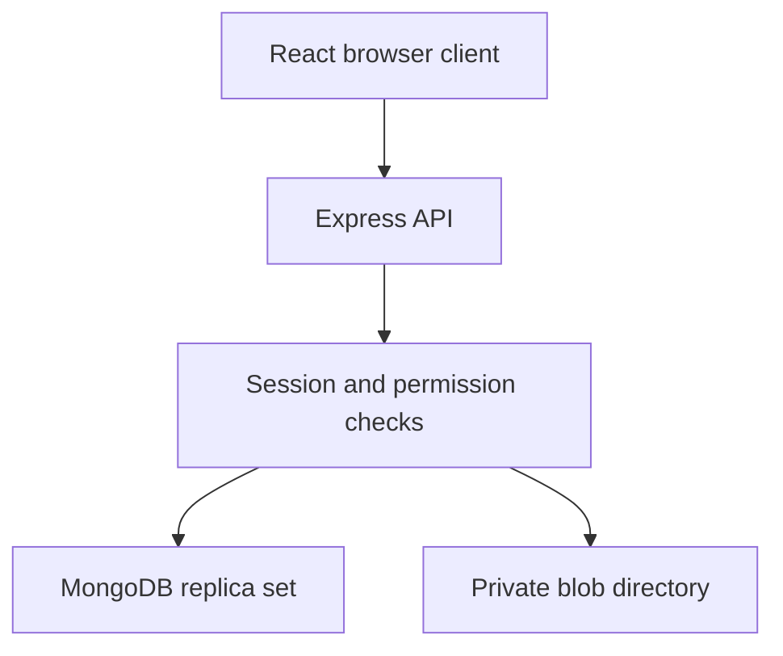

# Architecture

Drivebox uses a same-origin React client and Express API, with MongoDB metadata and separately stored file bytes. In development, Vite proxies `/api`; in production Express serves `client/dist`. The storage directory is never a public static directory.



## Persistence model

| Collection | Key fields | Important indexes and relationships |
| --- | --- | --- |
| User | name, normalized email, passwordHash, quotaBytes, usedBytes, mutationSerial | Unique email. A tree's owner pays for its retained blobs. `mutationSerial` serializes same-owner transactions. |
| Session | tokenHash, userId, expiresAt | Unique token hash; user lookup; expiry TTL. Expiry is also checked on requests because TTL removal is asynchronous. |
| Item | name, nameKey, kind, parentId, ownerId, currentVersionId, size, mimeType, revision, isTrashed, trashedAt, shares | Parent and owner indexes; share recipient index; unique active sibling index on ownerId + parentId + nameKey. Parent references form the folder tree. |
| FileVersion | fileId, blobId, number, size, mimeType, createdBy, createdAt | Unique fileId + version number. Immutable version entries point to blobs. |
| Blob | opaque key, ownerId, size, createdAt | Unique generated key; owner lookup. One disk file per blob record. |

The `unique_active_sibling` partial index applies when `isTrashed=false`. Names are normalized to Unicode NFC and lowercased for the index; the display name is retained. Both files and folders occupy the same namespace. Transactions and the database index jointly prevent races in duplicate-name checks.

Folders have no binary content. Items point to their parent rather than embedding entire subtrees, so moves update a single item's parent. Every descendant retains the same owner; cross-owner moves are rejected. Ancestor walks enforce folder access, detect trash, and validate move destinations. Hierarchy depth is capped at 100, including move validation of descendants. Very wide hierarchies would benefit from a separately maintained ancestor/path index and more efficient traversal; this implementation favors readable correctness for a take-home-sized dataset.

## Sessions and authorization

Passwords use Node's salted scrypt. A fresh random session token is stored in an HttpOnly, SameSite=Lax cookie; only its HMAC hash is stored in MongoDB. The cookie is Secure when the configured browser origin uses HTTPS. The server checks session expiry independently of background TTL cleanup. Logout removes the server-side session and clears the cookie.

The API validates identity for every item, version, share, list, and download operation. Owners have full control. Editors can create children, rename, upload versions, and restore earlier versions. Viewers can read, list, download, and inspect version history. Move, trash, trash restore, and share management require ownership.

Effective access is the strongest grant on the item or any ancestor. A directly shared descendant does not grant access to its parent, and breadcrumbs include only accessible context. A trashed item or ancestor blocks ordinary access and sharing. Inaccessible IDs return 404. A visible item with an insufficient role returns 403. Share APIs expose and alter direct grants only, so removing a direct grant can leave inherited access in place.

Unsafe browser requests must use the configured origin. CORS is restricted to that origin, and cookies are not exposed to client JavaScript. Request size limits, upload bounds, response security headers, authentication rate limiting, normalized identifiers, and field allowlists reduce input abuse. Filenames cannot contain path separators, control characters, `.` or `..`. Disk paths use server-generated opaque keys, never supplied filenames. Downloads force attachment handling; declared MIME types are metadata, not trusted proof of content.

## Mutation and upload lifecycle

MongoDB is a replica set because application metadata updates use transactions. A write to the owner's `mutationSerial` record happens inside a mutation transaction; competing changes to the same owner's tree conflict and retry against a fresh snapshot. This prevents stale sharing, move, and quota checks from committing concurrently. A caller-supplied item `revision` additionally protects against stale user-interface changes; it is optional for API callers.

An upload follows this sequence:

1. Authenticate and accept one size-limited multipart file into the private storage layer using a generated key.
2. Start the metadata transaction, serialize against the owner's current state, and recheck access, destination, duplicate names, revision, and available quota.
3. Insert the Blob and FileVersion records, create or update the Item, and increment the owner's usage atomically.
4. Commit before returning success. If validation or commit fails, remove the unreferenced uploaded bytes.

Transaction retries contain no irreversible filesystem operations. Disk writes occur before the metadata transaction, and failure cleanup occurs outside it. Cleanup preserves bytes if the commit outcome is unknown or MongoDB is unavailable, avoiding deletion of a possibly committed file. Consequently, a process crash or ambiguous failure can leave an orphan disk file, but cannot make an uncommitted upload visible as a successful file. There is no distributed transaction between MongoDB and local disk. Storage hardware loss or manual deletion can still leave referenced bytes unavailable; downloads return `503 FILE_UNAVAILABLE` instead of creating replacement content.

The orphan cleanup utility compares disk blobs older than 24 hours with MongoDB references. Use its default dry-run mode first, back up data, and stop all app writers before deletion. For a local server using the same `.env` and storage path:

```bash
npm run cleanup --workspace @drivebox/server
# Stop every API instance before applying; this flag acknowledges that requirement.
npm run cleanup --workspace @drivebox/server -- --apply --server-stopped
```

For Compose, stop `app`, then use `docker compose run --rm --no-deps app npm run cleanup --workspace @drivebox/server` to dry-run against the existing mounted data; add `-- --apply --server-stopped` only when all writers are stopped. Restart `app` afterward. The age threshold avoids treating newly written, not-yet-committed blobs as routine cleanup candidates. Database and disk backups must represent the same recovery point.

## Versions, trash, and quota

Every replacement upload creates a distinct immutable version and blob. Restoring a version creates another version entry that references the retained historical blob. Version numbers continue increasing. The current Item fields are updated to match the restored version, while the earlier timeline remains inspectable.

Quota is the sum of owned stored blobs, including old versions and trashed items. Reference reuse during version restoration incurs no additional bytes. Editor uploads charge the tree owner. The quota check and usage increment run inside the same serialized transaction, so simultaneous uploads cannot each consume the same remaining capacity.

Trash is soft deletion. Trashing a folder hides its descendants without changing their ownership or direct grants. Restoring returns an item to its original parent unless an alternative destination is supplied; missing/trashed parents, duplicate sibling names, and invalid destinations return a conflict or validation failure. Permanent purge and historical-version removal are not implemented. A user who reaches quota must receive an administrative quota increase or have a future purge feature implemented; putting files in trash alone does not free bytes.

## Operational scope and trade-offs

- Local opaque-file storage keeps the exercise self-contained, but a single local disk is not a highly available cloud storage service. Multiple API instances require shared storage or an object-storage adapter and review of disk cleanup coordination.
- The Compose database uses one replica-set member to provide transaction semantics, not replication redundancy. It has no published database port and is intended for a private local demo. A hosted deployment needs authenticated MongoDB, TLS, backups, proper secrets, reverse-proxy configuration, and recovery procedures.
- Registration is open; email verification, password reset, account recovery, invitations, admin quota management, and per-IP rate limiting across multiple replicas are not implemented.
- Search is a scoped escaped filename match. Full-text, file-content, and MIME-type search are not included.
- Restore reuses blob references; there is no content-hash deduplication across different uploads. Resumable uploads, preview workers, public sharing links, audit logs, and load testing are not included.
- Page-number pagination is simple and stable enough for demonstration workloads; very large, rapidly changing collections would benefit from cursor pagination.

## Primary references

- [MongoDB: Atomicity and transactions](https://www.mongodb.com/docs/manual/core/write-operations-atomicity/)
- [MongoDB: Convert a standalone to a replica set](https://www.mongodb.com/docs/manual/tutorial/convert-standalone-to-replica-set/)
- [Express: Production security practices](https://expressjs.com/en/advanced/best-practice-security/)
- [Docker: Compose startup and shutdown order](https://docs.docker.com/compose/how-tos/startup-order/)

These references informed the transaction, security, and startup choices. They do not replace running the project's tests and validating a deployment in its target environment.
